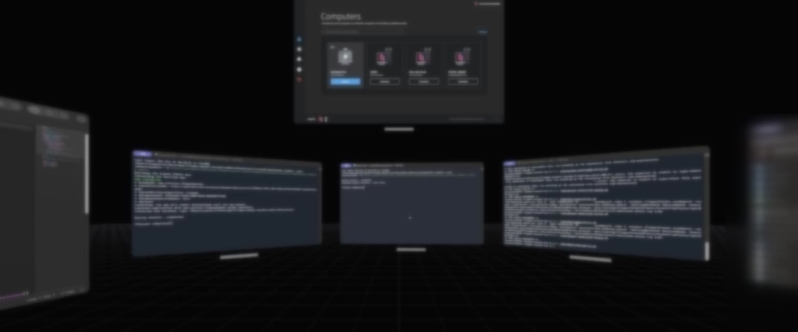
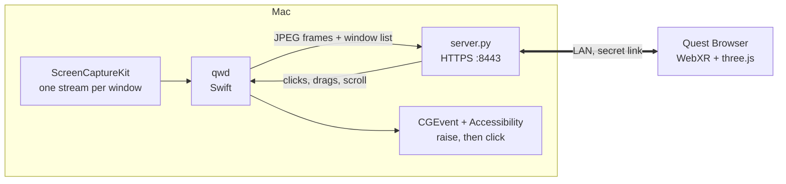

<h1 align="center">Quest Windows</h1>

<p align="center">
  <em>Your Mac's windows, floating in your room. One window, one panel.</em>
</p>

<p align="center">
  
  
  
  
  
  
</p>

<p align="center">
  
</p>

<p align="center">
  <strong>Not a virtual monitor. Every macOS window is its own panel you can grab, place and use.</strong><br>
  <sub>Window contents are blurred here. In the headset they're sharp.</sub>
</p>

---

Two posts went around: [one](https://x.com/asciidiego/status/2113795531650818065) put Compiz back on macOS, [the next](https://x.com/azlenelza/status/2114178886754054540) floated macOS windows around in 3D. Neither shipped code. This puts that second idea inside a Quest 3, where it belongs.

No app to sideload. No SIP tricks. No private compositor patching. Four files, one install script, and the browser that is already on your headset.

## What you get

- **Every window, live.** Each on-screen window streams on its own, even when it's covered by another window on the Mac.
- **Point and click.** Trigger or pinch is a left click, grip is a right click, the thumbstick scrolls. Double-clicks and drags work.
- **Covered windows come forward.** Click a panel whose window is buried on the Mac, and it's brought to the front before the click lands.
- **Menus show up where you expect.** Context menus, dropdowns and popovers appear on top of the window they belong to.
- **Move things around.** Pinch the bar under a panel to carry it. While you hold it, the thumbstick pushes it away or pulls it in.
- **AR or VR.** Panels float in your room over passthrough, or in a dark void with a grid floor.
- **Your trackpad still works.** A dot shows the Mac's own cursor on whichever panel it's over, and the Mac keyboard types into the window you last clicked.
- **Only runs while you watch.** Capture starts when the headset connects and stops when it leaves. While it runs, the Mac's display stays awake.

## Install

On the Mac (Xcode or its command line tools, macOS 14 or later):

```bash
git clone https://github.com/Cartterr/quest-windows ~/quest-windows
sh ~/quest-windows/install.sh
```

It prints a link like `https://192.168.1.55:8443/<secret>/`. Then:

1. **Grant two permissions, once.** System Settings → Privacy & Security → turn on **QuestWindows** under *Screen & System Audio Recording* and under *Accessibility*.
2. **Open the link in Quest Browser.** The certificate is self-signed, so tap *Advanced → Proceed*.
3. **Tap Enter AR.**

Bookmark the link. The server starts at login, so next time you just open the bookmark.

Everything looks too small or too big? Add `?s=0.0012` to the link (metres per macOS point; the default is `0.0009`).

## How it works



| File | Job |
|---|---|
| `qwd.swift` | Captures each window with ScreenCaptureKit, writes JPEG frames to stdout, and replays pointer events from stdin as real mouse events |
| `server.py` | Python standard library only. Serves the page over HTTPS and starts `qwd` while a viewer is connected. Queues only the newest frame per window, so slow Wi-Fi drops frames instead of falling behind |
| `index.html` | The WebXR scene: panels, controller and hand rays, grab handles, the Mac cursor dot |
| `install.sh` | Builds `qwd`, creates the token and certificate, and installs a login item |

**Why there's a tiny `QuestWindows.app`.** macOS ties Screen Recording and Accessibility permissions to the app that asks for them. `install.sh` builds a 10-line launcher app once, and everything else runs as its child. You can rebuild `qwd` as often as you like without granting anything again.

**Bandwidth.** A frame is sent only when the window's pixels actually change. An idle desktop sends almost nothing, and scrolling one window costs a few MB/s.

## Security

Anyone with the link can see every window on your Mac and click anything. Treat the link like a password.

- The link holds a random 128-bit token. Any other path returns `404`.
- Traffic is TLS, but with a self-signed certificate, so use it on networks you trust.
- Nothing listens on the internet unless you forward port 8443 yourself. Don't.

## Limits

- The menu bar and Dock aren't mirrored. Use keyboard shortcuts, or Spotlight (⌘Space), which isn't filtered out.
- There's no virtual keyboard yet. Type on the Mac's keyboard.
- The Mac must stay awake and unlocked. A locked screen has nothing to capture.
- Text is softer than in a native app. WebXR compositor layers would sharpen it, and H.264 with WebCodecs would cut the bandwidth. Both would be welcome PRs.

## Turn it off

```bash
launchctl bootout gui/$(id -u)/com.carter.questwindows
launchctl disable gui/$(id -u)/com.carter.questwindows
```

To turn it back on: `launchctl enable gui/$(id -u)/com.carter.questwindows && sh ~/quest-windows/install.sh`.

## License

MIT
